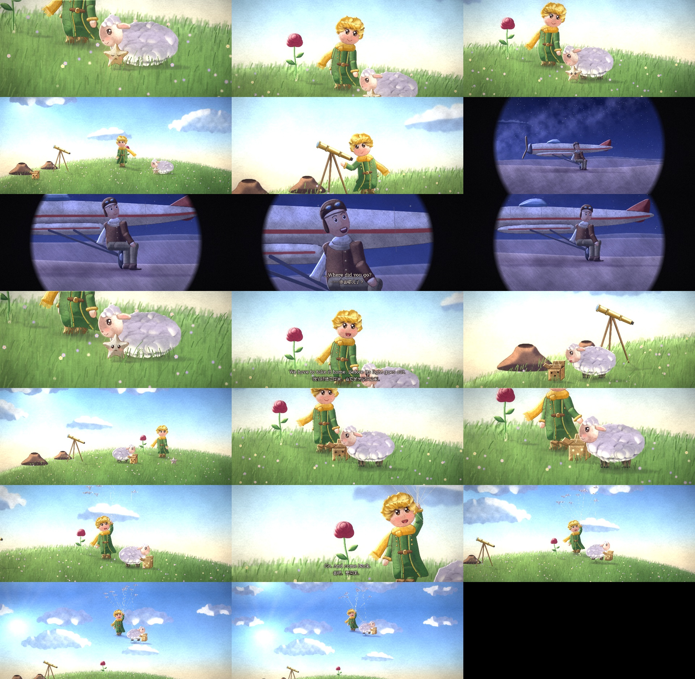

# The Fallen Star — a 60-minute painted film made in pure Python

The pilot's laughing star falls to asteroid B612, and the boy, his sheep and the little star Pip carry it home.
Every frame is painted by code: brush strokes, light, characters and motion are all numpy/OpenCV. No images or 3D models are used.
Subtitles are in English and 中文, with a synthesized score and no voices.



## Layout
| Path | What it is |
|---|---|
| `core.py` | the painting engine: brush strokes, washes, paper, scene light (`core.ENV`) |
| `rig.py`, `motion.py`, `cam.py` | character rigs, natural motion curves, camera |
| `boy2.py`, `boy_anim.py`, `sheep.py`, `sheep_anim.py`, `pip.py`, `pilot.py`, `moth.py`, `clockmaker.py` … | characters |
| `bg.py`, `env.py`, `places.py`, `props*.py` | backgrounds and props |
| `film/s01.py` … `film/s13.py` | the 13 scenes: shots, acting, subtitles, sound cues |
| `film/base.py`, `film/cast.py`, `film/audio.py` | scene framework and music/sound synth |
| `film/render_scene.py`, `film/join_scene.py`, `film/par.sh` | restart-safe chunked renderer |
| `trailer/` | the 59-second trailer (picture + score) |
| `stills/` | one check frame per scene |
| `docs/` | plan, script, production notes |
| `*_try.py`, `test_*.py`, `shot_test*.py` | look-development tests |
| `old-cutout-version/` | the first, rejected cut-out version (kept for the record) |

## Render
Requires Python 3 with numpy, opencv-python, Pillow and scipy, plus ffmpeg.

```bash
bash film/par.sh s01        # 4 workers render scene 1 in 30 s chunks, then join it -> out/scenes/S01.mp4
python3 film/render_scene.py s05 2   # a single worker; 2 = motion-blur samples per frame
```
Each scene takes about 2 hours on 4 cores. Re-running a script skips chunks that are already finished.

## Rebuild the whole film
```bash
for s in s01 s02 s03 s04 s05 s06 s07 s08 s09 s10 s11 s12 s13; do bash film/par.sh $s; done
bash film/join_film.sh      # joins out/scenes/S01..S13.mp4 -> out/The_Fallen_Star.mp4 (60:00)
```
The whole hour takes about 26 hours on 4 cores (about 20 minutes of rendering per minute of film).
All pictures and sound are made by the code, so nothing else is needed.
A rebuild gives the same film, but the file is not byte-for-byte identical (video encoding and library versions differ slightly).
